# Usakame 30 Games — 工夫点・おすすめポイントまとめ

`ROADMAP.md` に沿って制作した全30タイトルの遊びどころ、技術的な工夫点、スクリーンショット映えポイントをカテゴリ別にまとめています。

---

## カテゴリ A: ハイテンポ・アーケードアクション (01–05)

### 01. GRAPPLE ASCENT (`games/01_grapple_ascent.rb`)
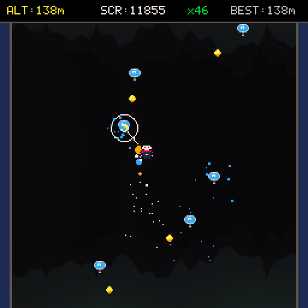
- **おすすめポイント**: 1ボタン（`Z` / クリック）で最も有利な上方アンカーを自動ターゲットし、振り子物理の遠心力を活かして溶岩から逃げ切る爽快な縦登りアクション。
- **工夫点**: 黄色い「ブーストアンカー」に触れた瞬間の自動大ジャンプ＋ヒットストップ、速度に応じた残像トレイル、溶岩から立ち昇る火花パーティクル、シェイク時の `:cave` 背景スケーリング（`scale: 1.04`）による黒隙間防止。

### 02. PARRY DOJO (`games/02_parry_dojo.rb`)
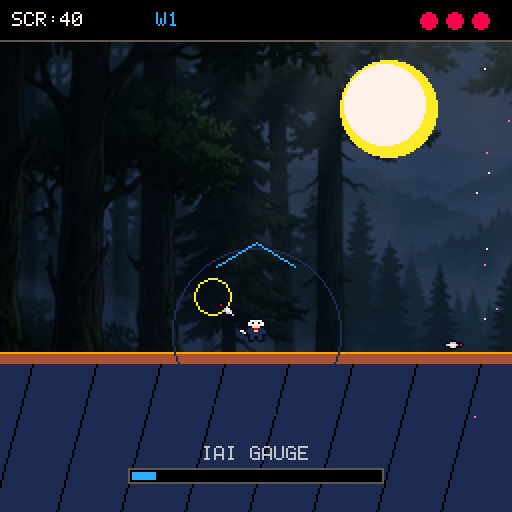
- **おすすめポイント**: 4方向から飛来する矢・手裏剣・忍びをタイミング良く斬り払う1ボタン居合道場。ジャスト見切りで弾を跳ね返し、背後の敵を連鎖撃破できる。
- **工夫点**: 満月＋`:forest` 紺ティント＋舞い散る桜吹雪の雰囲気作り、ジャスト判定時の4フレームヒットストップ＆シアンフラッシュ、ゲージ100%で発動する全体必殺技「月光居合」。

### 03. GRAVITY FLIP RUN (`games/03_gravity_flip_run.rb`)
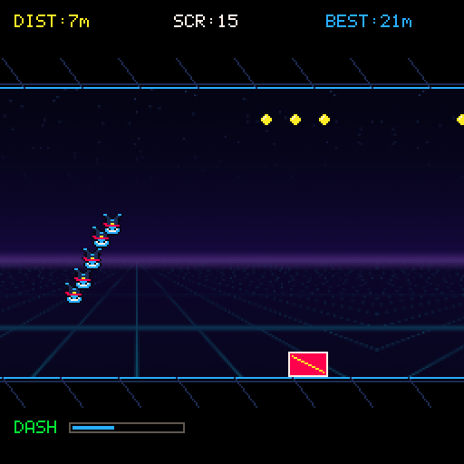
- **おすすめポイント**: 床と天井を瞬時に反転させながらネオン回廊を疾走するスピードラン。フェーズダッシュで空中ドローンを体当たり破壊できる攻めの爽快感。
- **工夫点**: `@PALETTE 11` を使ったシアン残像トレイル、コヨーテタイム＆先行入力バッファによるキレの良い反転操作、距離に応じて変化する `:cyber` 背景ティント。

### 04. SKY JUGGLER (`games/04_sky_juggler.rb`)
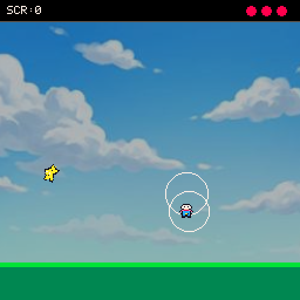
- **おすすめポイント**: 降ってくる敵を落とさずアッパー＆ポゴ踏みで空中お手玉し続けるコンボアクション。
- **工夫点**: 10コンボ達成で背景が `:sky` からサイケデリックな `:cyber` へ変貌する「FEVER MODE」、アッパーヒット時の2段ジャンプ回数回復による滞空ループ。

### 05. DRIFT CIRCUIT (`games/05_drift_circuit.rb`)
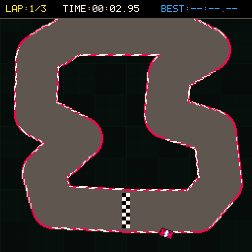
- **おすすめポイント**: タイヤ痕とドリフト火花を散らしながら3周タイムアタックに挑む見下ろしレース。ベストラップを「シアン色のゴーストカー」として再生できる。
- **工夫点**: 進行方向と車体向きの横滑りグリップ物理、ドリフト溜め時間に応じた青→橙→ピンクの火花と解放時ターボ加速、赤白縁石とチェッカーフラッグの視認性。

---

## カテゴリ B: シューティング & 物理アクション (06–10)

### 06. STAR DIVER (`games/06_star_diver.rb`)

- **おすすめポイント**: 都市夜景→山脈→青空→深宇宙→電脳空間へと連続的に背景が移り変わる、3択ビルド型の縦スクロールSTG。
- **工夫点**: ゾーンボス撃破ごとに提示される3択アップグレード（拡散弾・連射・ウィングマン・攻撃力・回復・ノヴァボム）と、`Array` ベースの重複なし抽選（Fisher-Yates）。

### 07. TANK RICOCHET (`games/07_tank_ricochet.rb`)
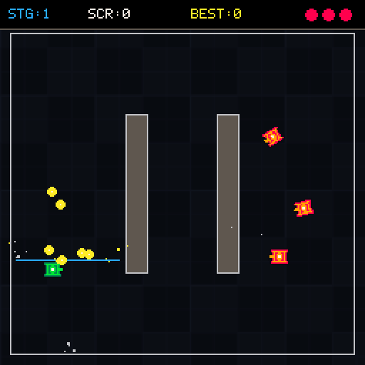
- **おすすめポイント**: 壁で最大2回跳弾する砲弾とリアルタイムの反射予測線で、障害物の陰にいる敵戦車を狙撃するタクティカル戦車バトル。
- **工夫点**: `compute_ricochet_pts` による1バウンド目までのレーザー予測線、マウスエイムとキーボード自動追尾のハイブリッド操作、青スナイパー戦車との駆け引き。

### 08. COMET LASSO (`games/08_comet_lasso.rb`)
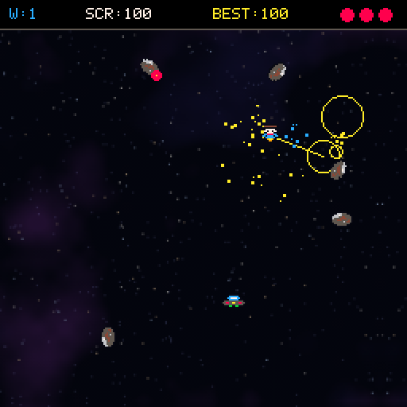
- **おすすめポイント**: 近くの小惑星をエネルギー投げ縄で捕獲し、自分の周囲で高速回転させてからUFO群へ投げ飛ばす物理アクション。
- **工夫点**: 投げ飛ばした小惑星が複数のUFOを貫通・連鎖爆破した際の `CHAIN x2, x3...` スコア倍率とヒットストップ＆衝撃波リング。

### 09. PINBALL CYBER (`games/09_pinball_cyber.rb`)

- **おすすめポイント**: ネオンバンパーが弾け、上部3つのドロップターゲットを全点灯させると最大3球の「マルチボール」が炸裂するサイバーピンボール。
- **工夫点**: 4サブステップ物理と線分距離計算によるフリッパーの正確な弾き返し（フリッパー上昇中のキック加速対応）とテーブルナッジ機能。

### 10. SUBMARINE SONAR (`games/10_submarine_sonar.rb`)

- **おすすめポイント**: 暗黒の深海でソナー波紋を放ち、闇に潜むアンコウや巨大イカ、機雷を暴き出して魚雷を撃ち込む緊張感ある探索バトル。
- **工夫点**: ソナー波紋が触れた瞬間だけ敵スプライトとロックオンリングが浮かび上がる視界演出と、発見状態の敵に魚雷を当てた際の「2倍クリティカル」仕様。

---

## カテゴリ C: パズル・思考 & ローグライト戦略 (11–15)

### 11. AUTO CHESS MINI (`games/11_auto_chess_mini.rb`)

- **おすすめポイント**: 4×4マスのお手軽盤面で、同種ユニットを3体集めて自動★進化させながらウェーブを勝ち抜くミニ・オートバトラー。
- **工夫点**: 購入時に空きマスへ自動配置＆3体揃った瞬間の連鎖合体進化、同クラス2種によるシナジーバフ、マウスとキーボード双方での直感的な配置入替。

### 12. ORBIT TD (`games/12_tower_defense_orbit.rb`)
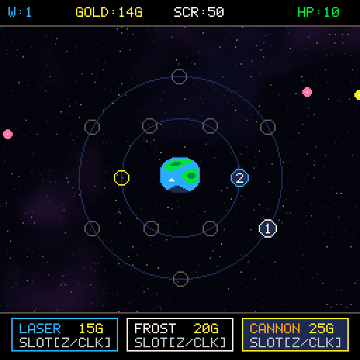
- **おすすめポイント**: 中央の母星を取り囲む2重リング（計12スロット）に、レーザー・範囲冷凍・範囲砲台の3種タレットを配置・強化する全方位TD。
- **工夫点**: 全360度から迫る敵に対する軌道リング配置の戦略性と、FROSTの拡大冷凍リング・CANNONの着弾爆風など視認性の高い攻撃エフェクト。

### 13. SLIDING KNIGHT (`games/13_sliding_knight.rb`)

- **おすすめポイント**: 氷の床を壁にぶつかるまで一直線に滑り抜き、進路上の敵を一撃で斬り伏せるローグライト詰めタクティクス。
- **工夫点**: 1回のスライドで複数体を斬るほど倍率が伸びる連続コンボと、詰み防止＆緊急回避用の周囲4マス攻撃「旋風斬り（NOVA）」。

### 14. ALCHEMY MERGE (`games/14_alchemy_merge.rb`)
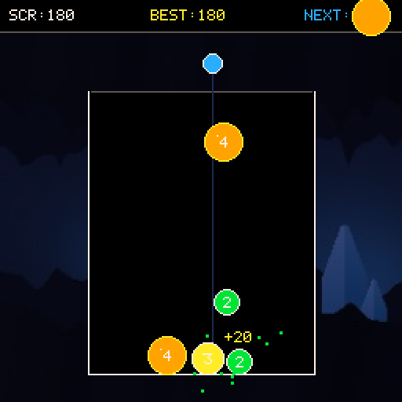
- **おすすめポイント**: フラスコの中で転がり跳ねる9段階の魔法玉を合体進化させるスイカ風マージパズル。
- **工夫点**: 4サブステップの円同士反発物理による自然な転がり挙動、合体時の衝撃波＆ポップアップ演出、次の玉（NEXT）表示と危険ライン警告。

### 15. DICE DUNGEON (`games/15_dice_dungeon.rb`)
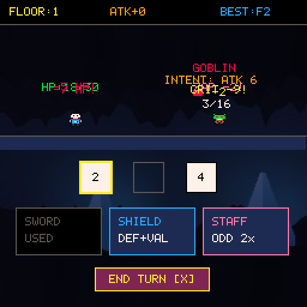
- **おすすめポイント**: 毎ターン振られる3つのダイスを「剣（攻撃）」「盾（防御）」「杖（奇数限定2倍魔法）」のスロットに割り振って戦うダイス構築RPG。
- **工夫点**: 敵の「次の行動予兆（INTENT: ATK X）」を見ながら防御と攻撃を配分する思考性と、6の目でのクリティカル＆階層突破時のHP回復・攻撃力成長。

---

## カテゴリ D: スポーツ・ミニゲーム & タイムアタック (16–20)

### 16. NEON AIR HOCKEY (`games/16_neon_air_hockey.rb`)

- **おすすめポイント**: マウス操作で直感的にパックを弾き、タイミング良くクリック/Zで超高速「パワースマッシュ」を叩き込める4段階CPUトーナメント。
- **工夫点**: 4サブステップ物理による高速パックの壁抜け防止、残像トレイル、ゴール時の大量火花とスクリーンシェイク。

### 17. GOLF GALAXY (`games/17_golf_galaxy.rb`)
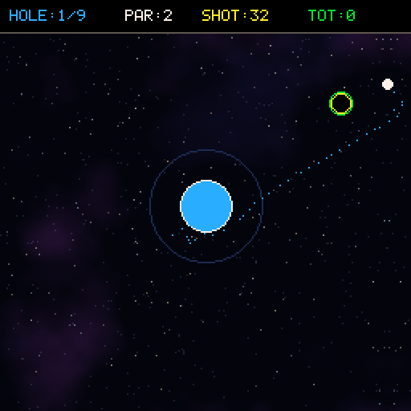
- **おすすめポイント**: 惑星の万有引力で曲がる弾道を予測線で見極めながら、全9ホールのワープカップを狙う宇宙物理パターゴルフ。
- **工夫点**: 各惑星の重力圏リング表示と、リアルタイム重力計算をそのまま42ステップ先読みして描画する「曲がる軌道予測線」。

### 18. FISHING TWILIGHT (`games/18_fishing_twilight.rb`)
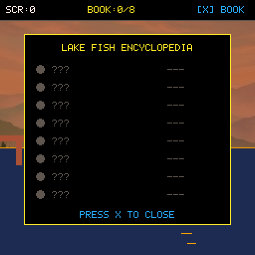
- **おすすめポイント**: 夕暮れの湖畔で8種類の魚（伝説の LAKE KING まで）を釣り上げ、図鑑コンプリートを目指す癒やし＆駆け引き釣りゲーム。
- **工夫点**: 夕日の水面反射アニメーション、魚影の回遊、引きの強さが種族ごとに異なるゲージ制リールバトルと `[X]` でいつでも開ける魚図鑑。

### 19. SUSHI CONVEYOR (`games/19_sushi_conveyor.rb`)

- **おすすめポイント**: 4人の客の吹き出し注文を見て、マグロ・サーモン・玉子・エビを爆速で握って皿を飛ばす回転寿司アクション。
- **工夫点**: 16×16ドット絵で描いた4種の寿司ネタと回転ベルト演出、同じネタを待つ客の中で「最も怒りゲージが迫っている客」へ自動優先配達する快適な操作感。

### 20. RHYTHM SMITH (`games/20_rhythm_smith.rb`)

- **おすすめポイント**: 収束するタイミングリングが金床に重なる瞬間にハンマーを振り下ろし、5段階の名剣を鍛え上げる鍛冶リズムクラフト。
- **工夫点**: PERFECT時の火花シャワー＋画面フラッシュ＋打撃シェイクによる無音でも伝わる気持ちいい打撃感と、品質スコアに応じた `S/A/B/C` ランク判定。

---

## カテゴリ E: シミュレーション・クリッカー & 育成 (21–25)

### 21. PIXEL AQUARIUM (`games/21_pixel_aquarium.rb`)
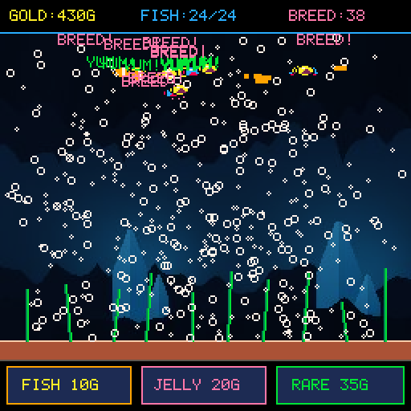
- **おすすめポイント**: カクレクマノミ・ネオンテトラ・クラゲ・レア魚が泳ぐ水槽にエサをまき、コインを回収して繁殖させる癒やし系アクアリウム。
- **工夫点**: 揺らぐ水草と立ち昇る気泡の環境演出、エサを3回食べると新世代が誕生する繁殖システム、放置でもコインが貯まるまったりサイクル。

### 22. FALLING SAND LAB (`games/22_falling_sand_lab.rb`)

- **おすすめポイント**: 砂・水・木・火・TNT爆薬・酸・石の7素材＋消しゴムを自由に描き、連鎖反応を観察できる60FPS物理サンドボックス。
- **工夫点**: 64×54セル配列＋更新済みフラグによる高速セルオートマトン、水で火が消え・火で木とTNTが爆散し・酸が砂や木を溶かす化学反応ルール。

### 23. DUNGEON SHOPKEEPER (`games/23_dungeon_shopkeeper.rb`)
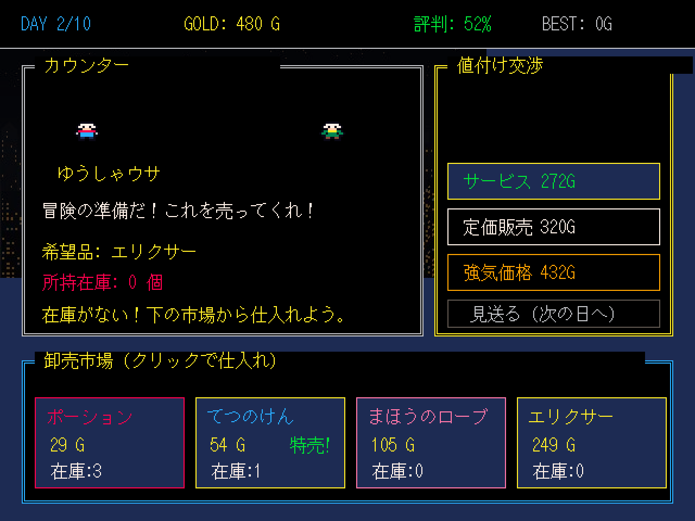
- **おすすめポイント**: `640×480` VGA解像度・東雲16px日本語フォント採用の道具屋経営シム。10日間の営業で仕入れと強気/サービス値付けを駆使して最高資産を狙う。
- **工夫点**: PC-98風の二重枠ウィンドウUI、卸売市場の「特売！」相場変動、ショップ評判に応じて成功率が変化する3段階の値付け交渉。

### 24. COLONY ORBIT (`games/24_colony_orbit.rb`)
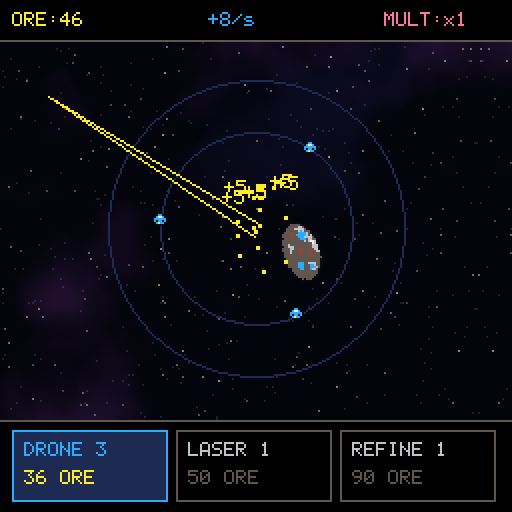
- **おすすめポイント**: 巨大な結晶小惑星をクリックでレーザー採掘し、自動採掘ドローンやレーザー衛星、精製倍率を強化していく宇宙インクリメンタル。
- **工夫点**: 購入数に応じて小惑星周囲を実際に周回して自動レーザーを撃つドローン群と、着弾時の小惑星パルス拡大アニメーション。

### 25. MONSTER BREEDER (`games/25_monster_breeder.rb`)
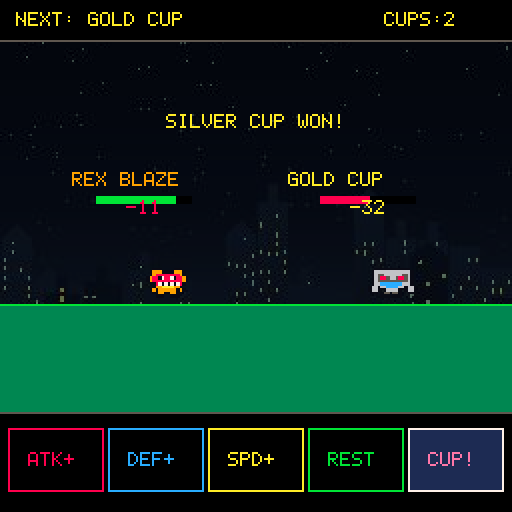
- **おすすめポイント**: ATK/DEF/SPDの特訓バランスによって全8種類のドット絵モンスターへ分岐進化し、4つの大会制覇を目指す育成ゲーム。
- **工夫点**: 幼体→第2段階3種→最終段階4種（均等育成での隠し形態 `COSMIC KING` 含む）の分岐設計と、特訓画面からそのまま突入するオートバトル大会。

---

## カテゴリ F: SNS映え特化・アート & 実験的トイ (26–30)

### 26. FIREWORKS DIRECTOR (`games/26_fireworks_director.rb`)
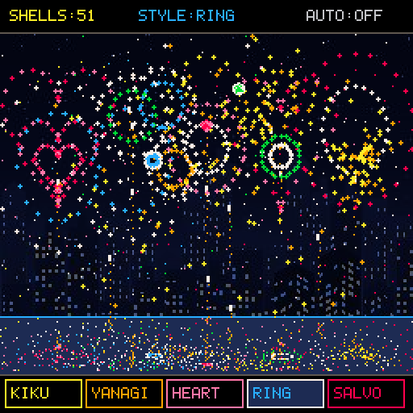
- **おすすめポイント**: クリックした夜空の高さへ「菊」「柳」「ハート」「冠菊」「5連発（SALVO）」を打ち上げられる花火師トイ。
- **工夫点**: 都市夜景の下部に設けた港の水面に花火の火花が揺らぎながらリアルタイム反射する演出と、観賞用のオート花火大会モード。

### 27. KALEIDOSCOPE BLOOM (`games/27_kaleidoscope_bloom.rb`)
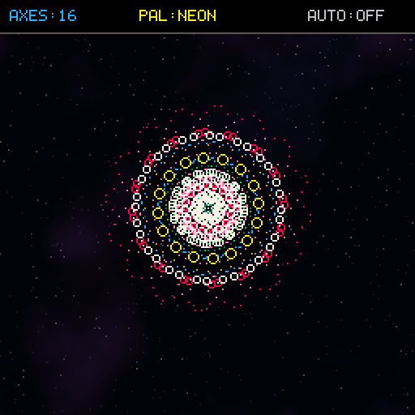
- **おすすめポイント**: 8 / 12 / 16軸の放射対称ミラーリングで光の曼荼羅アートが咲くジェネラティブ万華鏡トイ。
- **工夫点**: リサージュ軌道による自動ブルームとマウス描画のシームレス切替、4種類のカラーテーマ（NEON / SAKURA / GOLD / ABYSS）切替。

### 28. WORLD GLIDER (`games/28_world_glider.rb`)
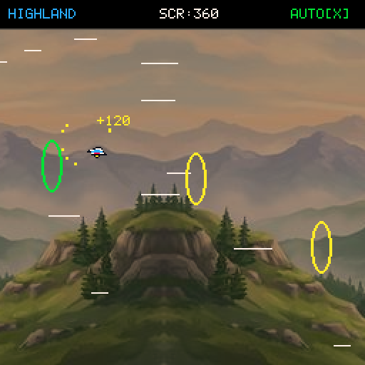
- **おすすめポイント**: Usakame内蔵の全8種BG（`:sky`〜`:training`）を風に乗って順番に巡りながら、空中の輪をくぐってコンボを重ねるチル系グライダー。
- **工夫点**: 無操作3秒（または `X` キー）で輪を自動で追尾する「チル・オートパイロット」機能と、上下速度に応じた機体ピッチ回転。

### 29. RETRO SYNTH VISUALIZER (`games/29_retro_synth_visualizer.rb`)
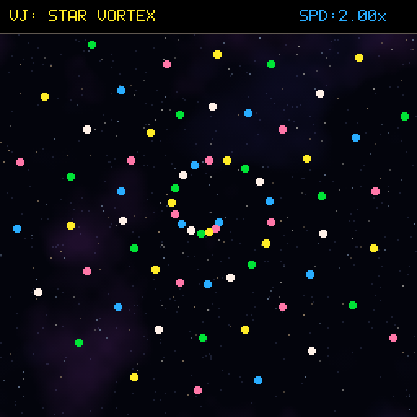
- **おすすめポイント**: 3Dワープトンネル、3Dワイヤーフレーム立方体、シンセウェーブ＋スペアナ、螺旋スター・ボルテックスの4モードを操るデモシーンVJトイ。
- **工夫点**: 3軸回転＋透視投影を1から組んだ3Dワイヤーキューブと、スピード調整・ビートドロップ衝撃波（`X`）によるライブVJ感。

### 30. USAKAME MUSEUM (`games/30_usakame_museum.rb`)

- **おすすめポイント**: 30本完結記念の歩ける展示室。各カテゴリの代表ドット絵がレッドカーペットの台座に並び、近づくと解説パネルと祝砲コンフェッティが舞う。
- **工夫点**: 全6つの展示ブースを巡り終えると博物館全体で祝福メッセージが表示されるコレクション達成演出。
